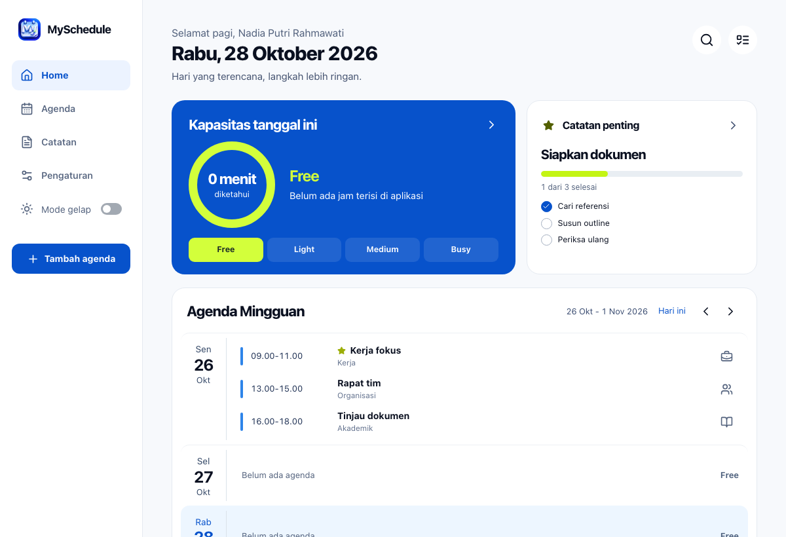
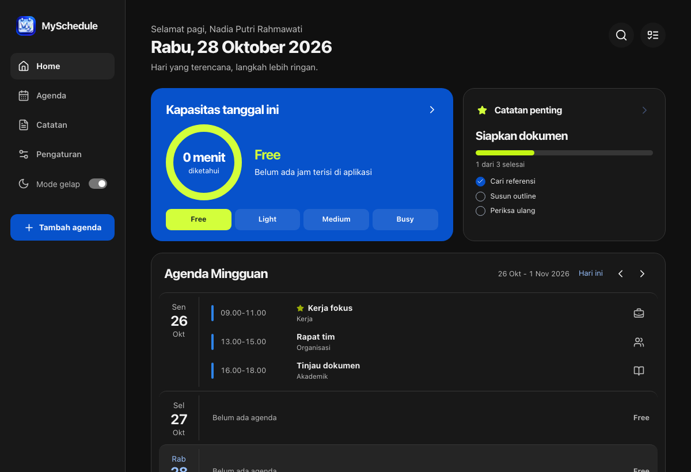

# MySchedule Manager - Panduan Rilis

Kelola agenda, lihat kapasitas harian, dan pantau persiapan melalui catatan serta checklist. MySchedule Manager adalah alat bantu perencanaan pribadi, bukan pengganti seluruh fitur Google Calendar.

[Buka aplikasi](https://myschedulemanager.netlify.app/) · [Instalasi lokal](#menjalankan-secara-lokal) · [Panduan deployment](../DEPLOYMENT.md) · [Privasi](https://myschedulemanager.netlify.app/privacy/)

> **Status per 30 Oktober 2026: pratinjau publik.** Frontend dan halaman legal sudah tersedia. Pemeriksaan produksi masih mengembalikan `/health/ready` **503** dan `database: not_ready`, sehingga login belum tersedia. Panduan ini mendokumentasikan fitur yang sudah diimplementasikan; bukan pernyataan bahwa seluruh alur produksi atau verifikasi Google telah selesai.

## Tampilan aplikasi



*Tangkapan antarmuka aplikasi dengan data ilustrasi. Nama, tanggal, agenda dan catatan pada gambar bukan data akun pengguna. Gambar ini menunjukkan contoh tampilan, bukan bukti sesi produksi yang sudah berhasil masuk.*

<details>
<summary>Lihat tampilan mode gelap</summary>



*Mode gelap memakai data ilustrasi yang sama. Sumber dan cara penggunaan aset dijelaskan dalam [catatan aset preview](../frontend/assets-source/preview-README.md).*

</details>

## Fitur yang tersedia

| Bagian | Kemampuan pada rilis awal |
| --- | --- |
| Home | Kapasitas harian, catatan penting, dan agenda mingguan. Tanggal hari ini mengikuti zona waktu profil. |
| Agenda | Tambah, lihat, edit dan hapus agenda; pilihan waktu/durasi, pengulangan, kategori, status dan label. Klik tanggal untuk menambah agenda atau membuka detail hari. |
| Catatan | Judul, isi, target tanggal, penanda Important, pencarian dan filter status. |
| Checklist | Tambah, ubah dan urutkan langkah; centang progres; selesaikan atau buka kembali catatan secara eksplisit. |
| Pengaturan | Zona waktu, preferensi jam pengingat, tema terang/gelap, dan pilihan penyimpanan browser. Preferensi pengingat belum mengirim notifikasi. |
| Privasi | Data dipisahkan per akun. Penyimpanan tema dan cache agenda memerlukan pilihan terpisah dan dapat dinonaktifkan kembali. |

Kapasitas dihitung dari durasi agenda: **Free** 0 jam, **Light** lebih dari 0 dan kurang dari 6 jam, **Medium** 6-10 jam, dan **Busy** lebih dari 10 jam. Waktu yang bertumpuk dihitung sekali. Agenda tanpa durasi ditandai agar perkiraan tidak dianggap lengkap.

## Mulai menggunakan

Setelah layanan login tersedia:

1. Buka aplikasi dan pilih **Masuk dengan Google**. Akun dibuat setelah identitas Google terverifikasi; tidak ada allowlist email aplikasi. Akses tetap mengikuti konfigurasi Google dan status akun.
2. Periksa **Pengaturan** untuk memastikan zona waktu sesuai. Agenda yang sudah disimpan tidak berubah hanya karena zona profil diganti.
3. Pilih **Tambah agenda**, atau klik tanggal pada Home untuk mulai dari hari yang dimaksud. Periksa kembali tanggal, waktu dan durasi sebelum menyimpan.
4. Gunakan **Catatan** untuk rincian persiapan dan checklist. Catatan tidak memesan jam dalam agenda; mencentang semua langkah tidak otomatis menyelesaikan catatan.
5. Pada perangkat bersama, pilih **Hanya yang wajib** dan keluar dari akun setelah selesai.

Jika tombol masuk belum tersedia, jangan menganggap contoh pada halaman Welcome sebagai data akunmu. Periksa status layanan atau hubungi pengelola.

## Privasi dan penyimpanan

- Login Google hanya meminta `openid`, `email` dan `profile`. Aplikasi tidak meminta akses Gmail, Drive, kontak atau Google Calendar.
- Cookie login/OAuth tetap diperlukan. Pilihan penyimpanan diingat selama 180 hari untuk browser/domain yang sama, bukan otomatis di perangkat lain.
- **Ingat tema tampilan** bersifat opsional; cookie tema berumur 30 hari. Tanpa izin, pergantian tema tetap bekerja selama halaman terbuka.
- **Simpan agenda di perangkat** bersifat opsional. Cache disimpan menurut akun dan zona waktu; cache lebih tua dari 30 hari tidak dipakai dan dibersihkan pada penulisan berikutnya. Ini bukan jaminan penghapusan otomatis saat situs tidak dibuka, enkripsi lokal, atau login offline.
- Buka **Pengaturan cookie** dari footer Welcome, halaman legal atau Pengaturan akun untuk mengubah pilihan. Menarik izin membersihkan penyimpanan opsional yang dikelola aplikasi, bukan data server.
- Hapus agenda/catatan masih memakai **soft-delete**. Permintaan salinan data atau penghapusan akun ditangani manual melalui [maliknahar.mn@gmail.com](mailto:maliknahar.mn@gmail.com), dengan verifikasi kepemilikan yang wajar. Jangan mengirim kata sandi, OTP atau token Google.

Dokumen publik dapat dibaca tanpa login atau JavaScript:

- [Kebijakan Privasi](https://myschedulemanager.netlify.app/privacy/)
- [Ketentuan Layanan](https://myschedulemanager.netlify.app/terms/)
- [Kebijakan Cookie](https://myschedulemanager.netlify.app/cookies/)

## Batas rilis awal

- Pengingat Google Calendar, pengiriman notifikasi, dan ekspor agenda `.ics` belum tersedia.
- Pengelolaan prasyarat catatan yang saling terhubung belum menjadi fitur aktif.
- Penghapusan akun dan ekspor data penuh belum tersedia sebagai tombol mandiri. Keluar akun atau mencabut akses Google tidak menghapus seluruh data server.
- Ikon dan manifest instalasi sudah disediakan, tetapi service worker dan dukungan offline penuh belum ada.
- Tes lokal/CI dan emulasi Chromium tidak menggantikan pengujian login Google produksi, Safari/iPhone fisik, atau persetujuan Google.

## Menjalankan secara lokal

Prasyarat: **Python 3.13**, **PostgreSQL**, dan **Node.js >=22.12.0**.

1. Ikuti [instalasi backend](../backend/README.md#instalasi) untuk virtualenv, dependensi, konfigurasi database dan migrasi. Gunakan database development/test terpisah; jangan menjalankan provisioning ulang pada resource yang sudah ada.
2. Konfigurasikan [Google OAuth development](../backend/README.md#google-oauth-development). Simpan kredensial hanya di konfigurasi lokal/server, bukan `VITE_*`, dokumentasi atau bundle browser.
3. Jalankan API dari folder `backend/`:

   ```sh
   .venv/bin/python -m uvicorn myschedule.main:app --reload --host 127.0.0.1 --port 8000 --no-access-log
   ```

4. Di terminal lain, dari folder `frontend/`:

   ```sh
   npm ci
   npm run dev
   ```

5. Buka **http://localhost:5173**. Frontend meneruskan `/api` dan `/health` melalui origin yang sama untuk menjaga alur cookie dan CSRF.

## Verifikasi sebelum rilis berikutnya

Jalankan dari `frontend/` setelah konfigurasi pengujian backend disiapkan:

```sh
npm run build
npm test
npm run legal:test
npm run test:e2e
```

`legal:test` memeriksa output build, sehingga harus dijalankan setelah build. E2E memerlukan Chromium Playwright dan memakai port 4173/8001. Untuk lint dan tes PostgreSQL terpisah, ikuti [tes backend](../backend/README.md#tes-dan-kontrak).

Gate produksi:

- [ ] `/health/ready` mengembalikan 200 dan `/api/v1/status` menyatakan database siap sebelum login dibuka.
- [ ] Alur Google nyata berhasil: masuk, sesi, perubahan data dengan CSRF, pemisahan dua akun, dan keluar.
- [ ] Origin/callback HTTPS dan pengaturan Google sesuai domain produksi. Pemasangan meta tag kepemilikan bukan bukti verifikasi selesai; tuntaskan Search Console dan pengajuan branding sesuai instruksi Google.
- [ ] Halaman legal, tautan, pilihan cookie, serta tampilan desktop/mobile dan terang/gelap tetap berfungsi.
- [ ] Tidak ada secret, data akun, log pribadi atau dokumen perencanaan internal dalam commit dan output deployment.

## Referensi publik

| Dokumen | Isi |
| --- | --- |
| [Ringkasan repository](../README.md) | Pengenalan produk dan titik awal pengembangan. |
| [Frontend](../frontend/README.md) | Alur antarmuka, cache, tema, dan pengujian browser. |
| [Backend](../backend/README.md) | Instalasi API, database, autentikasi dan kontrak endpoint. |
| [Deployment](../DEPLOYMENT.md) | Konfigurasi Netlify/FastAPI Cloud, Google OAuth dan pemeriksaan produksi. |
| [Pemeliharaan kebijakan](../frontend/LEGAL.md) | Sumber dokumen legal dan batas operasional yang harus dipertahankan. |

Panduan ini adalah bagian dokumentasi publik. PRD, riset, catatan persetujuan, rancangan lama dan laporan audit pada subdirektori `docs/` tetap lokal; tidak disertakan atau ditautkan sebagai dokumen yang tersedia setelah clone repository.
